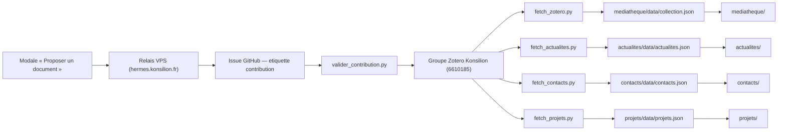
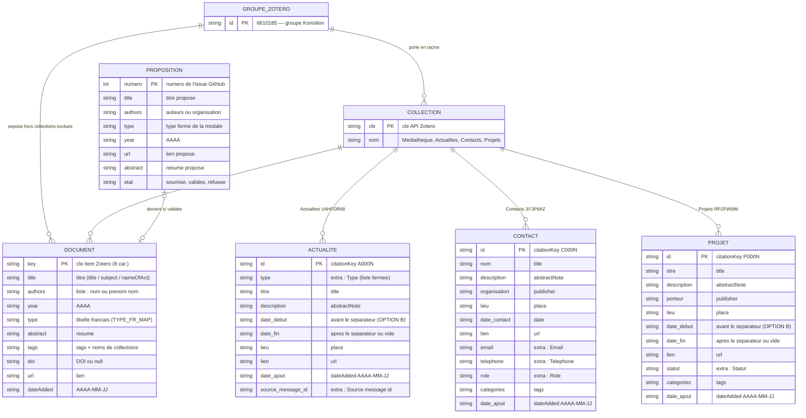
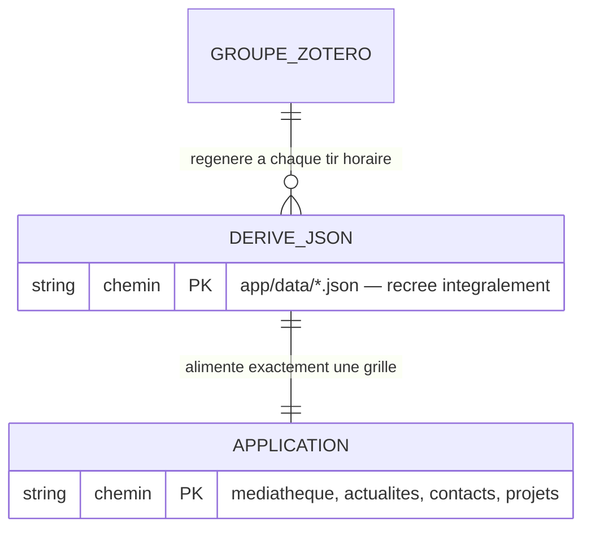

# Modèle conceptuel des données — Grilles de carte (Parlement de la rivière Isère)

Document de référence du dossier [`mcd/`](README.md). Il décrit **ce qui est** :
chaque règle renvoie au fichier qui l'applique (docstring, constante, section du
README). Le détail champ par champ est dans
[`dictionnaire-donnees.csv`](dictionnaire-donnees.csv), le parcours
contribution dans [`contribution.md`](contribution.md), le schéma d'ensemble
dans [`mcd.svg`](mcd.svg).

## 1. Périmètre

Le modèle couvre trois plans :

- **Les quatre applications** servies par GitHub Pages : `mediatheque/`,
  `actualites/`, `contacts/`, `projets/`.
- **Le pipeline de données** : groupe Zotero → scripts de fetch → fichiers
  `data/*.json` régénérés → fronts.
- **Le parcours contribution** de la médiathèque : modale → relais VPS →
  issue GitHub → modération → item Zotero.

Sont hors périmètre le code des fronts, la charte graphique et l'infrastructure
VPS — cités uniquement quand ils portent une règle de données (timer horaire,
relais, coffres de clés).

## 2. Vue d'ensemble



Deux sens de lecture :

- **Descente** — Zotero est l'unique source ; le pipeline régénère les dérivés
  toutes les heures (timer `grilles-parlement-sync`, tir à :07 →
  `scripts/deploy.sh` : 4 fetchs + commit + push) ; les fronts ne lisent que
  ces dérivés.
- **Remontée** — une proposition publique validée rejoint **Zotero** ; le
  prochain fetch la publie. Le cycle est fermé : rien ne contourne la source
  de vérité.

Version image : [`mcd.svg`](mcd.svg).

## 3. Entités et associations

### 3.1 Diagramme conceptuel



### 3.2 Lecture du modèle

- **GROUPE_ZOTERO** — le groupe Konsilion (`6610185`), unique source de
  vérité.
- **COLLECTION** — une collection racine du groupe. Quatre attendues :
  Médiathèque (`MCKNJI9M`), Actualités (`U4HFDR68`), Contacts (`JI7JP8AZ`),
  Projets (`RPZFWI9M`).
- **DOCUMENT** — un item Zotero du groupe **hors collections exclues**
  (règle R3) ; les propositions validées sont rangées dans la collection
  Médiathèque.
- **ACTUALITE, CONTACT, PROJET** — un item de la collection dédiée, restitué
  au front selon un contrat de champs fixe.
- **PROPOSITION** — une issue GitHub étiquetée `contribution` ; elle
  **devient** un document si elle est validée, sinon elle est fermée sans
  écriture Zotero. Détail : [`contribution.md`](contribution.md).
- **DERIVE_JSON, APPLICATION** — les fichiers régénérés et les grilles qui
  les consomment (section 3.3).

### 3.3 Dérivés et applications



- Chaque application consomme exactement un dérivé ; chaque dérivé alimente
  une seule application.
- `collection.json` est une enveloppe (`generated_at`, `collection_id`,
  `count`, `items`) ; les trois autres dérivés sont des listes plates triées
  par `id` — ordre déterministe, sortie reproductible (docstrings des fetchs).
- Un dérivé n'est jamais la source d'une autre entité : il est réécrit en
  entier à chaque tir, tout changement manuel est perdu (règle R2).

## 4. Règles de gestion

| # | Règle | Trace |
|---|---|---|
| R1 | Zotero (groupe Konsilion `6610185`) est l'**unique source de vérité** des quatre applications. | docstrings `scripts/fetch_*.py` ; README « Contacts / Projets — mécanique » |
| R2 | Les `data/*.json` du dépôt sont des **dérivés régénérés** à chaque tir horaire (timer :07 → `deploy.sh` : 4 fetchs + commit + push). On ne les édite jamais à la main : la correction se fait dans Zotero, le prochain fetch l'emporte. | `scripts/deploy.sh` ; README « Cron », « Fixture » |
| R3 | **Anti-fuite** : les collections Actualités (`U4HFDR68`), Contacts (`JI7JP8AZ`) et Projets (`RPZFWI9M`) sont exclues du fetch médiathèque. | `scripts/config.py` `ZOTERO_EXCLUDE_COLLECTIONS` ; docstring `fetch_zotero.py` |
| R4 | Labels du champ `extra` en **anglais sans accents**, un par ligne « Label: valeur » : `Email:`, `Telephone:`, `Role:`, `Statut:`, `Type:`, `Source message id:`. Label absent = chaîne vide. | `EXTRA_LABELS` + `parse_extra` des fetchs ; `build_extra` (`valider.py`) |
| R5 | **citationKey par app** : contacts `C000N`, projets `P000N`, actualités `A000N` — attribué par scan max+1 à la création. Unicité vérifiée à chaque fetch (doublon → échec). | `next_citation_key` (`ajouter_contact.py`, `ajouter_projet.py`), `next_id` (`valider.py`), contrôles `seen_ids` des fetchs |
| R6 | Médiathèque : item sans titre **écarté** du dérivé ; l'anti-doublon de la contribution porte sur le **titre exact** dans tout le groupe. | `fetch_zotero.py` `format_item` ; `valider_contribution.py` `load_memoire_items` |
| R7 | Clés de collections **attendues codées en dur et contrôlées** à chaque lecture/écriture (clé trouvée ≠ attendue → échec) : `MCKNJI9M`, `U4HFDR68`, `JI7JP8AZ`, `RPZFWI9M`. | `EXPECTED_COLLECTION_KEY` dans les 6 scripts |
| R8 | **Dates d'intervalle OPTION B** : `AAAA-MM-JJ` seul ou `AAAA-MM-JJ/AAAA-MM-JJ`, split sur « / ». | `parse_date` (`fetch_actualites.py`, `fetch_projets.py`) |
| R9 | `dateAdded` coupé à `AAAA-MM-JJ` dans les dérivés. | `item_to_record` des fetchs |
| R10 | **itemType** : contacts et projets `document` ; actualités `presentation` / `report` / `document` selon le type ; contribution → un des 14 types fermés de la modale. | `build_item` des `ajouter_*.py` ; `TYPE_TO_ITEMTYPE` (`valider.py`, `valider_contribution.py`) |
| R11 | **Pièges API Zotero** : un POST batch renvoie 200 même en échec (toujours vérifier `failed`) ; PATCH et DELETE exigent `If-Unmodified-Since-Version` ; `items/top` ne remonte pas les sous-collections. | docstring `zotero_api.py`, `post_items`, `patch_item`, `delete_item` |
| R12 | Un PATCH sur le champ `collections` **remplace toute la liste** : pour ajouter une appartenance sans perdre les autres, il faut renvoyer la liste complète. | sémantique API Zotero (piège documenté) |
| R13 | **Sécurité** : `scripts/config.py` (clé API) jamais commité (`.gitignore`) ; clés jamais affichées ni loguées ; la grille contacts est publique → n'y saisir que des coordonnées destinées à être publiées. | README « Sécurité », docstrings (`zotero_api.py` `load_key`) |
| R14 | **Suppression d'item Zotero : jamais de sa propre initiative** — présenter les constats, le CEO décide. | jalon CEO (mission MCD) |

## 5. Conventions de mapping par entité

Chaque tableau se lit « champ du dérivé ← champ Zotero ». Le détail complet
(types, exemples) est dans [`dictionnaire-donnees.csv`](dictionnaire-donnees.csv).

### 5.1 Document — médiathèque (`fetch_zotero.py`)

| Dérivé `collection.json` | Source Zotero | Note |
|---|---|---|
| `key` | `key` | identifiant ; pas de convention citationKey ici |
| `title` | `title` / `subject` / `nameOfAct` | selon itemType ; vide → item écarté (R6) |
| `authors` | `creators` | `name` (organisation) ou « prénom nom » |
| `year` | `date`, sinon `dateAdded`, sinon `issued` | 4 premiers caractères |
| `type` | `itemType` via `TYPE_FR_MAP` | libellé français |
| `abstract` | `abstractNote` | |
| `tags` | `tags` + noms des collections de l'item | dédoublonnés |
| `doi` | `DOI` | vide → `null` |
| `url` | `url` | vide → `null` |
| `dateAdded` | `dateAdded` | `AAAA-MM-JJ` (R9) |

### 5.2 Actualité (`fetch_actualites.py`)

| Dérivé `actualites.json` | Source Zotero | Note |
|---|---|---|
| `id` | `citationKey` | `A000N`, obligatoire, unique (R5) |
| `type` | `extra` « `Type:` » | liste fermée ; absent → fetch en échec |
| `titre` | `title` | |
| `description` | `abstractNote` | |
| `date_debut` / `date_fin` | `date` | split « / », OPTION B (R8) |
| `lieu` | `place` | |
| `lien` | `url` | |
| `date_ajout` | `dateAdded` | `AAAA-MM-JJ` (R9) |
| `source_message_id` | `extra` « `Source message id:` » | traçabilité du mail d'origine, anti-doublon |

### 5.3 Contact (`fetch_contacts.py`)

| Dérivé `contacts.json` | Source Zotero | Note |
|---|---|---|
| `id` | `citationKey` | `C000N`, unique (R5) |
| `nom` | `title` | requis (`ajouter_contact.py --nom`) |
| `description` | `abstractNote` | |
| `organisation` | `publisher` | |
| `lieu` | `place` | |
| `date_contact` | `date` | `AAAA-MM-JJ`, non splitté |
| `lien` | `url` | |
| `email` | `extra` « `Email:` » | R4, R13 |
| `telephone` | `extra` « `Telephone:` » | R4 |
| `role` | `extra` « `Role:` » | R4 |
| `categories` | `tags` | |
| `date_ajout` | `dateAdded` | `AAAA-MM-JJ` (R9) |

### 5.4 Projet (`fetch_projets.py`)

| Dérivé `projets.json` | Source Zotero | Note |
|---|---|---|
| `id` | `citationKey` | `P000N`, unique (R5) |
| `titre` | `title` | requis ; fetch en échec si absent |
| `description` | `abstractNote` | |
| `porteur` | `publisher` | |
| `lieu` | `place` | |
| `date_debut` / `date_fin` | `date` | split « / », OPTION B (R8) |
| `lien` | `url` | |
| `statut` | `extra` « `Statut:` » | conseillés : En cours / À venir / Terminé ; absent → le front déduit des dates |
| `categories` | `tags` | |
| `date_ajout` | `dateAdded` | `AAAA-MM-JJ` (R9) |

## 6. Protocole d'ajout / modification / suppression

| Entité | Ajout | Modification (enrichissement) | Suppression |
|---|---|---|---|
| Document (médiathèque) | contribution validée : `valider_contribution.py <n°>` ; ou saisie directe dans Zotero | PATCH via `scripts/zotero_api.py` (`patch_item`, garde `If-Unmodified-Since-Version`) puis relecture GET | décision CEO uniquement (R14) |
| Actualité | `python3 scripts/valider.py <numeros>` — depuis `actualites/data/pending_proposals.json` (propositions extraites du mail par le cron Hermes 08:15) | PATCH + relecture | décision CEO uniquement (R14) |
| Contact | `python3 scripts/ajouter_contact.py --nom …` | PATCH + relecture | décision CEO uniquement (R14) |
| Projet | `python3 scripts/ajouter_projet.py --titre …` | PATCH + relecture | décision CEO uniquement (R14) |
| Proposition (issue) | modale publique (relais VPS, repli GitHub manuel) | `valider_contribution.py <n°>` ou `--refuser "<motif>"` | pas de suppression : issues fermées, jamais effacées |

**Discipline commune** — s'applique à toute écriture :

- Jamais d'édition directe d'un `data/*.json` (R2) ; jamais d'appel API à la
  main quand un script existe.
- Un POST n'est cru qu'après lecture de `successful/failed` (R11) ; un PATCH
  exige la version courante de l'item (`If-Unmodified-Since-Version`) ; un
  PATCH sur `collections` renvoie la liste **complète** (R12).
- Après écriture : relecture de contrôle (les `ajouter_*.py` refont un fetch
  de la collection et vérifient la présence de l'item).
- La publication suit au prochain `deploy.sh` (tir horaire :07) — ou en le
  lançant à la main.

```bash
# contact
python3 scripts/ajouter_contact.py --nom "Marie Dupont" \
  --organisation "Conseil départemental" --lieu "Grenoble" \
  --email marie@example.fr --role "Élue" \
  --categorie institution --categorie eau

# projet
python3 scripts/ajouter_projet.py --titre "Où atterrir ?" \
  --porteur "Parlement de la rivière Isère" --statut "En cours" \
  --date-debut 2026-10-01 --categorie animation

# contribution : lister, valider, refuser
python3 scripts/valider_contribution.py --liste
python3 scripts/valider_contribution.py 12
python3 scripts/valider_contribution.py 12 --refuser "hors sujet"
```

## 7. Faire évoluer ce modèle

Le modèle vit avec les applications : la checklist de mise à jour est dans
[`README.md`](README.md) du dossier. Toute évolution d'un contrat de champs
doit se refléter dans le diagramme, les règles et le dictionnaire — pas
seulement dans le code.
