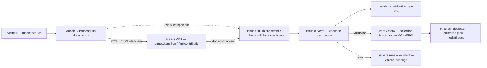
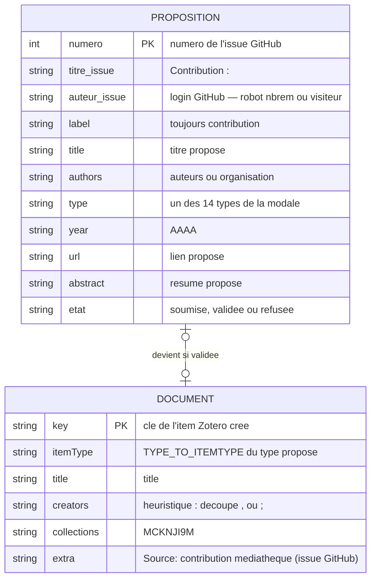
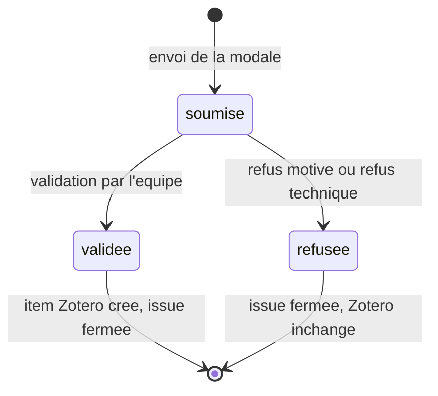

# Parcours contribution — modèle de données (médiathèque)

> Complète [`MODELE.md`](MODELE.md) pour l'entité **Proposition**. Le parcours
> « esprit Datami » permet à un visiteur de proposer un document sans compte et
> sans quitter le site ; l'équipe modère ; le document rejoint Zotero, puis la
> médiathèque au prochain déploiement.

## 1. Le parcours



Étapes, trace fichier par fichier :

1. **Modale** (`mediatheque/index.html`, champs `c-*`) : titre et lien
   requis, année sur 4 chiffres, 14 types fermés, champ anti-robots invisible
   `c-gotcha` (`name="website"`). Le JS valide puis envoie
   (`mediatheque/js/app.js`, `submitContribution` → `sendContributionSilent`).
2. **Relais VPS** (`~/parlement-contribution/server.py`, port 9135, derrière
   Caddy) : revalide tout, crée l'issue GitHub avec le jeton du robot `nbrem`
   (scope `public_repo`). Le visiteur ne voit jamais GitHub. En cas d'échec :
   **repli** automatique sur l'issue pré-remplie (parcours manuel) — aucune
   proposition n'est perdue.
3. **Issue GitHub** : titre `Contribution : <titre>`, étiquette
   `contribution`, corps = tableau lisible pour l'humain **+** bloc technique
   délimité ` ```json-contribution ` parsé par le script de modération. Le
   relais produit le même corps que le parcours manuel (`build_issue_body`,
   calque de `buildIssueBody` dans `app.js`).
4. **Modération** (`scripts/valider_contribution.py`) : `--liste` affiche
   les propositions en attente ; `<n°>` valide (anti-doublon titre exact,
   type revalidé, création de l'item Zotero dans la collection Médiathèque
   `MCKNJI9M`, fermeture de l'issue avec remerciement) ; `--refuser "<motif>"`
   ferme sans toucher à Zotero.
5. **Publication** : le prochain `deploy.sh` (tir horaire :07) régénère
   `collection.json` — le document apparaît sur la médiathèque.

## 2. Entité Proposition



## 3. Correspondance des champs

Formulaire → corps JSON du relais → corps de l'issue GitHub (bloc
`json-contribution`) → item Zotero créé par `valider_contribution.py`.

| Champ modale | Corps JSON relais | Bloc json-contribution | Champ Zotero | Règle |
|---|---|---|---|---|
| Titre (`c-title`, requis) | `title` | `title` | `title` | 300 car. max ; ≥ 3 car. côté relais ; obligatoire à la validation |
| Auteur·e·s (`c-authors`) | `authors` | `authors` | `creators` | 300 car. max ; découpe sur « , » / « ; » ; un mot = organisation (`name`), plusieurs = personne (`firstName`/`lastName`) |
| Année (`c-year`) | `year` | `year` | `date` | 4 chiffres (front : 1400–2100) |
| Type (`c-type`) | `type` | `type` | `itemType` | 14 types fermés, identiques dans la modale, le relais et le script ; inconnu → refus |
| Lien (`c-url`, requis) | `url` | `url` | `url` | 2000 car. max ; http/https, ≥ 12 car. côté relais ; obligatoire à la validation |
| Résumé (`c-abstract`) | `abstract` | `abstract` | `abstractNote` | 3000 car. max |
| Anti-robots (`c-gotcha`) | `gotcha` | — (jamais dans l'issue) | — | rempli → faux succès (202 côté relais), rien n'est créé |

Hors formulaire, l'item Zotero créé porte en plus (`build_item`) :
`collections = [MCKNJI9M]`, `extra` = `Source: contribution médiathèque
(issue GitHub)`, `tags = []`, `dateAdded`/`dateModified` = jour de la
validation, `date` = année si renseignée.

## 4. États



- **soumise** — issue ouverte étiquetée `contribution` (vue par `--liste`).
- **validée** — titre et lien présents, titre absent du groupe, type connu,
  POST Zotero réussi ; issue fermée avec remerciement.
- **refusée** — motif de l'équipe (`--refuser`), ou refus technique : doublon
  de titre exact, type inconnu, issue malformée (hors parcours modale → à
  traiter à la main), échec du POST Zotero.

## 5. Garde-fous

| Contrôle | Valeur | Trace |
|---|---|---|
| Champs requis | titre + lien | `mediatheque/index.html` (required), `server.py` `validate`, `valider_contribution.py` `do_validate` |
| Types fermés | 14 types, identiques partout | `index.html` `<select>`, `server.py` `TYPES`, `valider_contribution.py` `TYPE_TO_ITEMTYPE` |
| Tailles | titre/auteurs 300, lien 2000, résumé 3000 car. ; corps relais ≤ 20 Ko | `index.html` maxlength, `server.py` `MAX_BODY` |
| Anti-robots | honeypot `website` : rempli → faux succès, rien n'est créé | `app.js` `submitContribution`, `server.py` `do_POST` |
| Origine | CORS limité à `https://konsilion.github.io` | `server.py` `ALLOWED_ORIGIN` |
| Rate-limit | 15 requêtes/heure/adresse IP | `server.py` `RATE_MAX` |
| Discrétion | aucun jeton ni contenu dans les réponses ou logs ; erreurs GitHub → 502 générique | `server.py` `log_line`, `create_issue` |
| Anti-doublon | titre exact déjà présent dans le groupe → refus | `valider_contribution.py` `load_memoire_items` |
| Repli | relais indisponible → issue GitHub manuelle pré-remplie | `app.js` `sendContributionSilent`, `showContributeFallback` |

## 6. Traçabilité

- `mediatheque/index.html` — modale, champs `c-*`, types fermés.
- `mediatheque/js/app.js` — `buildIssueBody`, `sendContributionSilent`,
  `buildIssueUrl`, `submitContribution`.
- `~/parlement-contribution/server.py` — relais : validation, rate-limit,
  création d'issue (corps identique au parcours manuel).
- `scripts/valider_contribution.py` — modération : parse du bloc
  `json-contribution`, contrôles, création de l'item Zotero, fermeture
  d'issue.
- `scripts/deploy.sh` — publication du document au prochain fetch.
